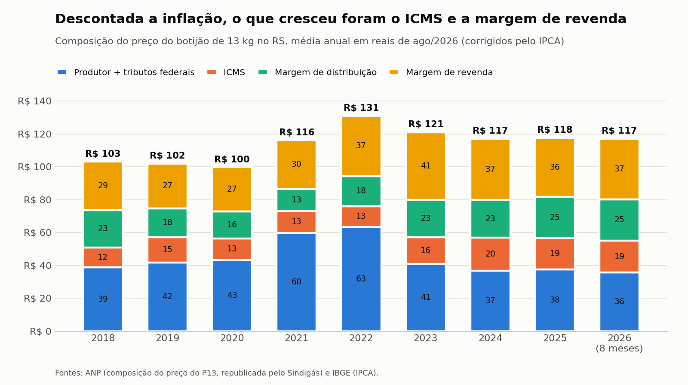

# Preço e margem do GLP (P13) no Rio Grande do Sul

Estudo de caso com dados públicos da ANP, do Sindigás e do IBGE.

**Painel interativo:** https://fabi3105.github.io/preco-gas-p13-rs/



## Pergunta

Para onde foi o aumento do gás de cozinha? O custo do produto na origem caiu em termos reais desde 2018, mas o botijão de 13 kg (P13) ficou mais caro no Rio Grande do Sul. O estudo mostra quem ficou com a diferença, onde o botijão é mais caro e o que esperar para 2027.

## Principais resultados

Valores em reais de ago/2026 (corrigidos pelo IPCA), média de 2018 contra a de 2026 até agosto.

| Parcela do preço | 2018 | 2026 | Variação real |
|---|---|---|---|
| Produtor + tributos federais | R$ 38,88 | R$ 35,75 | -8% |
| ICMS | R$ 11,91 | R$ 19,25 | +62% |
| Margem de distribuição | R$ 22,93 | R$ 25,29 | +10% |
| Margem de revenda | R$ 29,42 | R$ 36,81 | +25% |
| Preço ao consumidor | R$ 103,14 | R$ 117,10 | +13,5% |

- Quase toda a alta acima da inflação aconteceu em 2021 (+40,7% contra 10,1% do IPCA). Nos outros anos o botijão andou junto com o IPCA ou abaixo dele.
- Entre os municípios pesquisados, o preço médio dos últimos 12 meses vai de R$ 98,75 (Cruz Alta) a R$ 132,85 (Erechim). As quatro cidades da Serra Gaúcha ficam acima da média estadual.
- A diferença entre cidades vem mais da margem de revenda do que do preço de compra.
- O volume de P13 tem pico no inverno e caiu 10% entre 2018 e 2025; o preço não tem sazonalidade.
- Projeção para 2027: preço médio de R$ 123 no RS, com o botijão acompanhando a inflação. A regra foi escolhida por teste em seis pontos do passado (erro médio de 2,3% em 12 meses).

Os dados mostram que o ICMS e a margem de revenda cresceram, mas não explicam a causa. Margem bruta não é lucro.

## Fontes

- **ANP, Série Histórica de Preços de Combustíveis e de GLP**: preço por revenda e data de coleta, 2018 a 1º semestre de 2026.
  https://www.gov.br/anp/pt-br/centrais-de-conteudo/dados-abertos/serie-historica-de-precos-de-combustiveis
- **Sindigás, estatísticas ("Dados ANP")**: vendas por recipiente, consumo aparente e margens do P13 por estado.
  https://www.sindigas.org.br/?page_id=3026
- **IBGE, SIDRA tabela 1737**: número-índice mensal do IPCA, usado para descontar a inflação.
  https://sidra.ibge.gov.br/tabela/1737

## Limitações conhecidas dos dados

- O preço de compra da revenda ("Valor de Compra") só foi coletado até agosto de 2020. A margem por revenda só pode ser calculada até essa data; depois disso, o estudo usa as margens por estado.
- A pesquisa da ANP cobre poucos municípios (37 no RS no período). Na Serra Gaúcha aparecem Caxias do Sul, Bento Gonçalves, Vacaria e Gramado.
- Nos arquivos de 2018, toda revenda aparece com bandeira "BRANCA". A comparação entre bandeiras começa em 2019.
- Não houve coleta em setembro de 2020.
- A projeção repete a inflação recente e não antecipa mudanças de imposto, de preço do produtor ou de política de preços.
- A divisão entre ICMS e margem de distribuição oscila de um mês para outro até 2022, por causa da forma de recolhimento do imposto. As comparações usam médias anuais, e não meses isolados.
- A amostra foi reduzida em 2024 e 2025 por restrição orçamentária da ANP, o que afeta a comparação entre períodos.

## Como reproduzir

```
pip install -r requirements.txt
python scripts/baixar_dados.py          # baixa os arquivos da ANP e do Sindigás (cerca de 230 MB)
python scripts/01_tratar_precos.py      # preços por revenda no RS e médias mensais por UF
python scripts/02_extrair_composicao.py # composição do preço por UF, lida dos PDFs (requer pdftotext)
python scripts/03_analisar.py           # roda sql/consultas.sql e gera os resultados
python scripts/04_graficos.py           # gráficos da comparação com o IPCA
python scripts/05_projetar.py           # projeção de preço e volume até dez/2027, com teste do método
python scripts/06_montar_dashboard.py   # junta modelo, dados e logomarca em dashboard/index.html
```

## Estrutura

```
scripts/                   download, tratamento e análise
sql/consultas.sql          as consultas do estudo, uma por resultado
dados/brutos/              arquivos originais (fora do repositório)
dados/tratados/            bases prontas para análise (a de preços por revenda fica fora do repositório)
dados/tratados/resultados/ uma tabela por consulta
graficos/                  gráficos estáticos (PNG)
dashboard/                 painel interativo: modelo.html (fonte) e index.html (arquivo único, gerado)
```

## Identidade visual

O painel usa a identidade visual da Aliatti Comércio de Gás (cores e logomarca). O estudo é independente e não usa dados internos da empresa.
